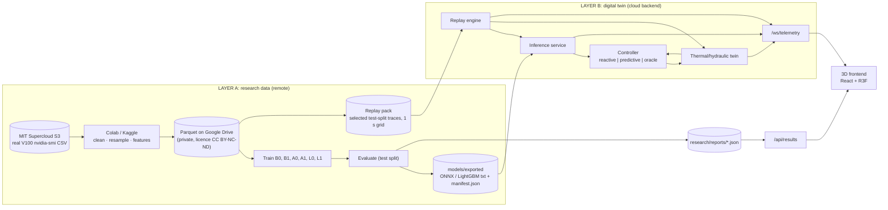
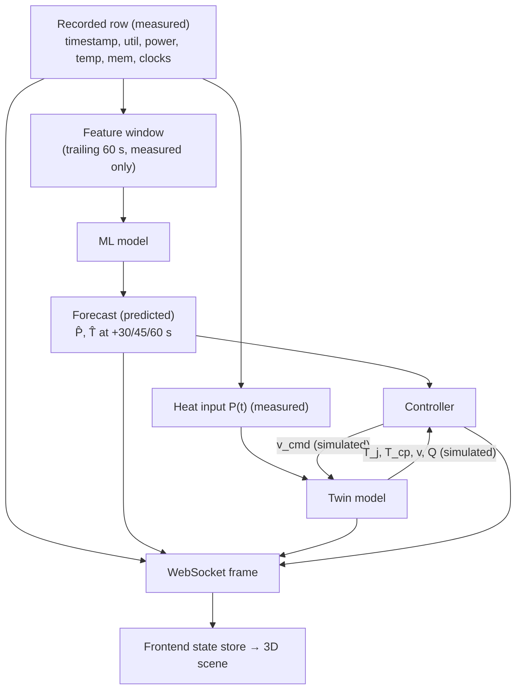
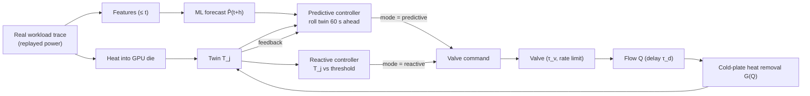

# System Architecture

Status: PLANNING DRAFT. Covers brief §53 items 3 (architecture), 6 (folder
structure), 7 (technology stack), 8 (data-flow diagram), 9 (control-loop diagram) and
10 (3D frontend architecture).

## 1. Overview



The backend never needs the full dataset: it loads the model artifact plus a small
replay pack (a few test-split traces at 1 s; size to be measured, target < 50 MB).

## 2. Data-flow diagram (brief §53.8)



## 3. Control-loop diagram (brief §53.9)



## 4. Backend (FastAPI)

| Module | Responsibility |
|---|---|
| `app/main.py` | FastAPI app, CORS, lifespan loads model + replay pack |
| `models/` | `ModelRegistry`: loads ONNX/LightGBM + manifest, validates feature list |
| `simulation/twin.py` | Equations from `docs/experiments.md` §4; pure, deterministic, unit-tested |
| `simulation/params.yaml` | All ASSUMED parameters, versioned |
| `controller/reactive.py`, `predictive.py`, `oracle.py` | Same interface: `step(state, forecast) → v_cmd` |
| `replay/engine.py` | Streams a selected trace at 1× (or N×) wall-clock speed |
| `websocket/telemetry.py` | `/ws/telemetry`; one frame per GPU per second |
| `experiments/compare.py` | Batch reactive vs predictive runs; writes `research/reports/e2_results.json` |
| `app/routes.py` | `/api/traces`, `/api/results`, `/api/dataset`, `/api/control` (mode, trace, pause) |

Run modes, distinguished in every frame by `mode`:
`RESEARCH_DATA_REPLAY` (measured telemetry streamed as recorded; twin runs alongside),
`DIGITAL_TWIN_SIMULATION` (twin driven by a real trace, user-selected controller),
`SIMULATION_WORKLOAD` (optional stress mode, clearly labelled, not research data).

## 5. Multi-GPU scene from single-GPU data

The dataset gives traces per `(job, gpu)`. The virtual data centre (e.g. 4 racks × 5
nodes) is populated by assigning **different real test traces** to each virtual GPU,
with the assignment listed in the UI. Racks are not claimed to be a recorded cluster.

## 6. WebSocket frame (`/ws/telemetry`)

```json
{
  "t": "2021-09-27T05:17:55Z",
  "gpu_id": "R01-G03",
  "trace": {"dataset": "mit-supercloud-202201", "job_id": "…", "gpu_index": 0},
  "mode": "DIGITAL_TWIN_SIMULATION",
  "controller_mode": "predictive",
  "workload": {"label": "resnet50", "source": "dataset_label"},
  "measured":  {"gpu_utilization": 97, "gpu_power": 231.4, "gpu_temperature": 63,
                "memory_utilization": 41, "sm_clock": 1380, "mem_clock": 877},
  "predicted": {"horizons_s": [30,45,60], "power": [ … ], "temperature_measured_system": [ … ],
                "model_id": "A1-lgbm-v1"},
  "simulated": {"twin_temperature": 71.2, "cold_plate_temperature": 55.0,
                "coolant_flow_lpm": 4.1, "valve_position": 0.52,
                "cooling_demand": 0.55, "est_pump_power_rel": 0.33}
}
```

Fields absent from a trace (e.g. clocks in 10-column files) are sent as `null` and the
UI hides them (brief §33). The values above illustrate the shape only.

## 7. Folder structure (brief §47, mapped onto the existing folder)

```
pred_cooling/
├── research/
│   ├── dataset_audit/          dataset_audit.md, audit JSON produced in Colab
│   ├── notebooks/              01_dataset_analysis … 06_experiment_comparison.ipynb
│   ├── src/                    shared preprocessing/feature code imported by notebooks
│   ├── configs/                preprocessing.yaml, split.yaml, models.yaml
│   ├── reports/                metric JSON written by notebooks (never hand-edited)
│   └── figures/
├── backend/
│   ├── app/  models/  simulation/  controller/  replay/  websocket/  experiments/
│   └── requirements.txt
├── frontend/
│   ├── src/{components,scene,racks,gpu,cooling,telemetry,prediction,control-room,results}
│   └── package.json
├── models/exported/            model files + manifest.json
├── legacy/                     current synthetic prototype pieces (if you approve D6)
├── docs/                       architecture.md, methodology.md, dataset.md,
│                               experiments.md, limitations.md
└── README.md
```

The existing `training/` notebooks would move to `legacy/` (synthetic), and the
existing `backend/` and `frontend/` code would be refactored into the layout above.

## 8. Technology stack

| Layer | Choice | Why |
|---|---|---|
| Training | Google Colab (Kaggle as fallback), Python 3.11, pandas/pyarrow, LightGBM, PyTorch, scikit-learn, onnx/onnxruntime | Brief §8, §45 |
| Data storage | Public S3 (source, read-only) → Google Drive Parquet (private) | Licence ND: processed data not redistributed |
| Backend | FastAPI, uvicorn, onnxruntime (CPU), numpy, pydantic | Light; no PyTorch needed at inference |
| Transport | WebSocket JSON at 1 Hz per GPU | Small frames; MessagePack if bandwidth becomes an issue |
| Frontend | React 18, TypeScript, Vite, three.js, @react-three/fiber, @react-three/drei, @react-three/xr (optional), Zustand, Tailwind, Recharts (results page only), Framer Motion (overlay UI) | Brief §25, §23 |
| Hosting | Frontend: Vercel. Backend: Render or Railway (one small instance) | Brief §46 |
| CI | GitHub Actions: unit tests for twin equations, leakage test, schema test | Reproducibility |

## 9. 3D frontend architecture (brief §53.10)

```
App
├── TelemetryProvider        WebSocket client → Zustand store (latest frame per GPU,
│                            ring buffer of last 120 s for the selected GPU only)
├── Overlay (DOM)            status bar (SYSTEM / MODEL / CONTROLLER), mode badge
│                            RESEARCH DATA REPLAY vs DIGITAL TWIN SIMULATION,
│                            bottom controls, trace picker (dataset labels only)
├── Canvas (R3F)
│   ├── SceneRoot            fog, lights (1 key + 1 fill + emissive), environment
│   ├── Room                 floor, walls, cable trays (static, merged geometry)
│   ├── RackArray            InstancedMesh for chassis; per-instance colour from
│   │   └── GpuNode[]        twin_temperature (65/75/80/85 °C bands, brief §31)
│   ├── CoolingLoop
│   │   ├── PipeNetwork      CatmullRom tubes; supply and return
│   │   ├── CoolantParticles one InstancedMesh/Points per pipe; speed ∝ coolant_flow_lpm
│   │   ├── Valve            handle rotation = valve_position × 90°
│   │   ├── Pump             impeller angular speed ∝ flow
│   │   └── CDU              heat-exchanger block, labels
│   ├── GpuDetail            chip, HBM stacks, cold plate, channels (shown in GPU view)
│   ├── PredictionPath       3D polyline of forecast points (+30/+45/+60 s)
│   ├── HoloPanel            drei <Html>/<Text> panels; shows only non-null fields,
│   │                        each value tagged MEASURED / PREDICTED / SIMULATED
│   ├── ControlRoom          large panels: fleet temps, demand, events, comparison
│   └── CameraDirector       named views (overview, rack, gpu, cooling, thermal,
│                            control room); event-follow sequence triggered by a
│                            backend `event` frame, never by a timer
└── ResultsPage (route)      reads /api/results; Recharts tables/plots of E1 and E2
```

Data-driven animation rule: every animated quantity reads from the store; components
interpolate toward the latest backend value (critically damped) but never invent a
target. Performance: instancing for racks/nodes/particles, ≤ 3 dynamic lights, no
shadows on particles, `frameloop="demand"` when paused, LOD for GPU detail.

WebXR: `@react-three/xr` `<XR>` wrapper behind a feature check; an ENTER VR button
appears only when `navigator.xr.isSessionSupported('immersive-vr')` is true.
